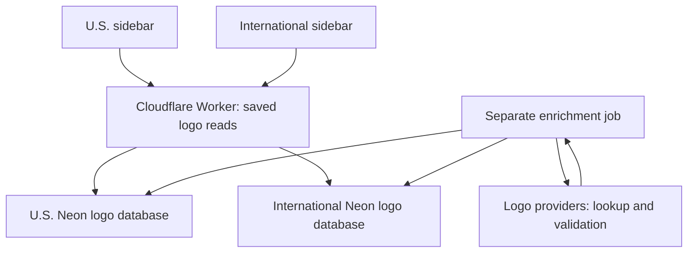

# Healthcare directory logo architecture

The final design uses **two separate logo databases**, as requested in the last part of
`Logo Caching Design.pdf`. The earlier proposal for a shared logo database is superseded.

| Directory | Facility records | Logo records | Worker binding |
| --- | --- | --- | --- |
| United States | HEALTHCARE_DIRECTORY | HEALTHCARE_DIRECTORY_LOGO_DATABASE (`falling-pond-02718824`) | HEALTHCARE_DIRECTORY_US_LOGO_DATABASE_URL |
| International | WORLD_HEALTHCARE_DIRECTORY, existing feature-global-directory branch | HEALTHCARE_DIRECTORY_INTERNATIONAL_LOGO_DATABASE (`blue-wildflower-46480541`) | HEALTHCARE_DIRECTORY_INTERNATIONAL_LOGO_DATABASE_URL |

The existing Render Static Site still serves the website. The Cloudflare Worker
`healthcare-directory-api.alexa186469.workers.dev` provides logo reads, enrichment, and existing
national registry requests. The Node backend is not needed for this feature.
Healthcare records, map geometry, region animations and navigation remain in their existing paths.



## Display

`facility-logos.js` batches up to 50 source-qualified facility IDs per request. A card uses a
32 px image container with `object-fit: contain`, including wide marks, and a healthcare icon
while no saved image is available. Broken images restore the healthcare icon. Titles remain
text. There are no viewer enrichment, upload, download, or export controls.

Public endpoints, all GET/HEAD only:

* `/logos/usa?source=directory&ids=123,456`
* `/logos/international?source=directory&ids=137400,137401`
* `/logos/{directory}/image/{source}/{id}` for a stored PNG.

Only status, provider, ID and display URL are returned. These routes never contact a logo
provider. JSON caches for 60 seconds; stored PNGs cache for a day. Registry API requests retain
the existing 60/minute best-effort per-isolate IP limit. Logo reads use a separate 240/minute
bucket so a page of images does not exhaust the registry limit. These limits are not globally
coordinated across Cloudflare isolates.

## Dedicated database schema

Both logo projects use the same schema in `worker/src/logo-db.js`:

* `brands`: normalized domain/name key, brand identity, provider, image/URL, status,
  lock/manual override, candidate, timestamps, retry time, and claim lease.
* `facility_brand_map`: composite `(facility_source, facility_id)` primary key, facility name,
  brand reference, match method/confidence, manual override. Directory and registry IDs do not collide.
* `logo_lookup_history`: provider, account binding name, outcome, HTTP status and timestamp.
* `logo_provider_accounts`: credential fingerprint and cooldown, never the actual credential.
* `logo_enrichment_state`: durable scan stage, ID cursor and job lease.

RLS is enabled without anonymous policies. The browser has no connection strings or write access.
The Worker uses Neon's serverless driver over HTTPS. Source facility tables are not modified.

A domain such as `biodiagnostica.com.mx` has one brand row referenced by several facility rows.
A successful lookup is locked. Another branch with that domain links to the saved brand without
another provider request. Explicitly verified parent organizations can be represented by pointing
multiple facility mappings to the same brand and marking their mappings as manual overrides.
The resolver does not infer parent relationships from loose name similarity.

## Resolver and credentials

1. Preserve existing locked, manual, not-found and review mappings.
2. Normalize the facility's website hostname; reject social/profile/directory hosts.
3. Reuse a saved brand for that domain.
4. Without a domain, use Logo.dev's name search. Require a unique exact normalized name,
   then corroborate its country and name with Brandfetch company metadata. Missing corroboration
   produces `review` with a retained candidate, rather than a guessed logo.
5. Fetch the domain's 64 px Logo.dev PNG and save its bytes in Neon (maximum 128 KiB).
6. If unavailable, use Brandfetch's brand API. Retain its supplied CDN URL and hotlink it;
   do not download Brandfetch Logo API assets into this database.
7. API Ninjas is the final name-search fallback. Its response lacks a domain/location,
   so exact name candidates are retained for explicit identity review.
8. A definitive miss becomes `not_found`; it is not automatically searched again.
   Transient failures become `error` and have a six-hour retry delay.

Supported pools (all existing Cloudflare bindings are retained as configured):

| Purpose | Bindings |
| --- | --- |
| Logo.dev search | LOGO_DEV_API_KEY, LOGO_DEV_API_KEY_2 |
| Logo.dev PNG | LOGO_DEV_TOKEN, LOGO_DEV_TOKEN_2 |
| Brandfetch identity and logo metadata | BRANDFETCH_API_KEY, BRANDFETCH_API_KEY_2 |
| API Ninjas fallback | NINJAS_API_KEY, NINJAS_API_KEY_2, NINJAS_API_KEY_3, NINJAS_API_KEY_4 |

Use account 1 normally; fail over after rate/quota/authentication rejection. Persist cooldowns
in the U.S. logo database so both directories respect the same credential availability.
Honor `Retry-After` where supplied; otherwise use conservative cooldowns (one hour for 429,
one day for other credential/quota rejections). A credential fingerprint change clears its
old cooldown. These are retry delays, not claims about account plan quotas or reset dates.
Each resolution is capped at four outbound provider requests. Deferred work remains an error
and can be retried later. Brand reservations prevent concurrent resolution of the same domain.

Brandfetch search needs a different client ID; the supplied Brandfetch API keys are used for
the Brand API, not misused as search client IDs. API Ninjas access/usage remains subject to the
account's plan. Logo.dev attribution is present on both pages. Current provider references:

* https://www.logo.dev/docs/brand-search/introduction
* https://www.logo.dev/docs/platform/self-hosting
* https://www.logo.dev/pricing
* https://docs.brandfetch.com/reference/brand-api
* https://docs.brandfetch.com/reference/brand-search-api
* https://api-ninjas.com/api/logo

## Enrichment and operations

A Cloudflare Cron Trigger runs each minute, alternating the two directories. Each invocation
processes one record, safely within the Worker subrequest limit, with a durable job lease.
Records with website URLs are scanned first; name-only records follow. On completing a cycle,
the scan restarts to discover later imports. Existing successes, misses and review cases remain
cached. Due transient failures are selected before the next scan record.

This is gradual enrichment, not an assertion that every facility already has a logo.
At verification time, U.S. records had no websites. The international directory had 10,975
website-bearing records out of 354,838 total. Name-only coverage is intentionally conservative.
Registry cards support source-qualified saved logo mappings, but live registry search is not
automatically harvested; the scheduled scan enriches the two stored directories.

Administrator-only enrichment can run in a trusted environment with the Cloudflare-named
variables available as environment variables:

```
node scripts/enrich-logos.mjs --directory international --batches 20
node scripts/enrich-logos.mjs --directory usa --file /private/facilities.json
```

A JSON row uses `id`, `name`, `website`, `city`, `country`, and optionally `source` (default
`directory`). For registry cards, use their normalized record ID and registry source slug.
Do not run this CLI in the public site. It preserves existing locked/manual/review/miss rows.

Inspect status in the relevant logo database:

```sql
SELECT status, count(*) FROM brands GROUP BY status;
SELECT provider, http_status, count(*) FROM logo_lookup_history GROUP BY 1, 2;
SELECT job, stage, cursor_value, lease_until FROM logo_enrichment_state;
```

Manual identity correction is an administrator operation: review `brands.candidate`, verify
the real organization, then update the brand/mapping with `manual_override=true` and lock the
approved brand. To retry a confirmed miss, explicitly change its status to `pending`, clear
its lock/retry/lease fields, and rerun the private enrichment command. Public viewers cannot
perform these operations. No existing successful logo is automatically refreshed or replaced.

## Verification

`npm test` includes identity normalization, success/miss/manual reuse, provider cooldown/failover,
shared-domain reuse, and refusal to lock uncorroborated name matches. Existing map tests also run.
The build keeps Worker files, credentials, scripts and dependencies out of public `dist`.
Live checks verify the stored PNG route and multiple facility mappings without another provider
call. Provider coverage and account entitlements must be judged from actual outcomes, not merely
from the presence of binding names.
